# EdgeVoice — 내 PC 에서 도는 AI 음성 비서

"Hey Jarvis" 라고 부르면 듣고, 생각하고, 말로 답합니다. 내 문서를 근거로 답하고, 말로 시키면 크롬·그림판을 움직입니다.
모든 AI(음성 인식·언어 모델·음성 합성·검색)는 이 PC(또는 사내 서버·Jetson)의 docker 안에서 돕니다.

<p align="center">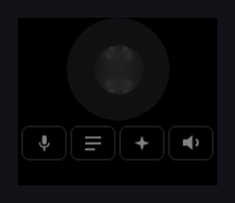</p>
<p align="center"><sub>화면 구석의 파형 창 — 대기(회색) → 듣기(파랑) → 생각(보라) → 말하기(초록)</sub></p>

## 필요한 것

| | AI 서버를 이 PC 에서 돌릴 때 | 앱만 (서버는 다른 PC) |
|---|---|---|
| OS | Windows 10/11 64비트 | Windows 10/11 64비트 |
| GPU | NVIDIA GPU, VRAM 16GB 이상 권장 (언어 모델이 약 15GB 를 잡는다) | 필요 없음 |
| 프로그램 | Docker Desktop (WSL2) + NVIDIA 드라이버 | — |
| 디스크 | 약 60GB (모델 약 18GB + Docker 이미지·캐시) | 약 100MB |
| 마이크·스피커 | 필요 | 필요 |

## 한눈에

| | |
|---|---|
| 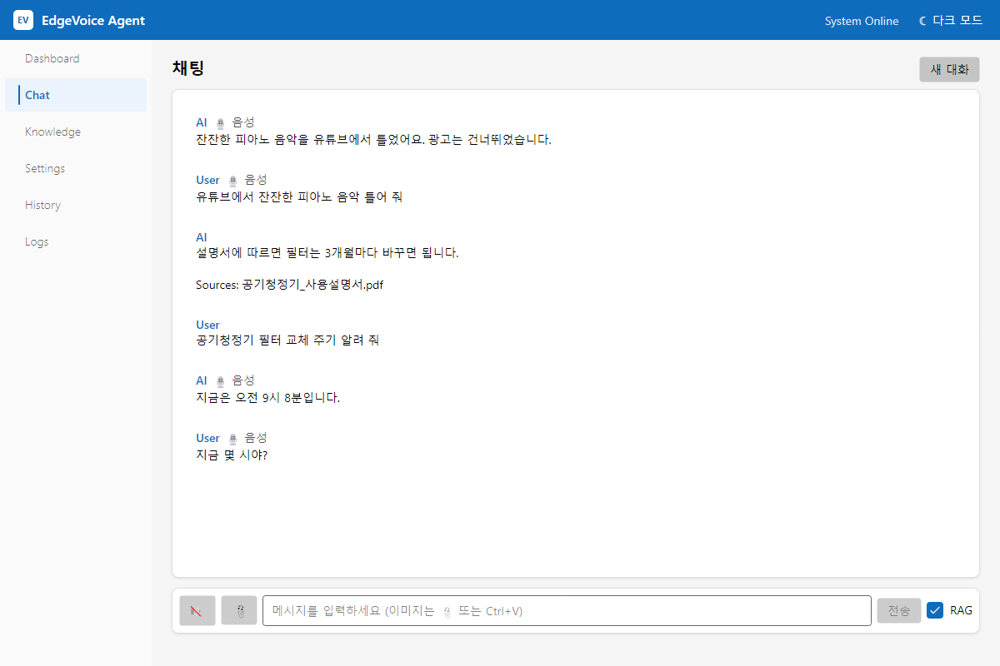 | 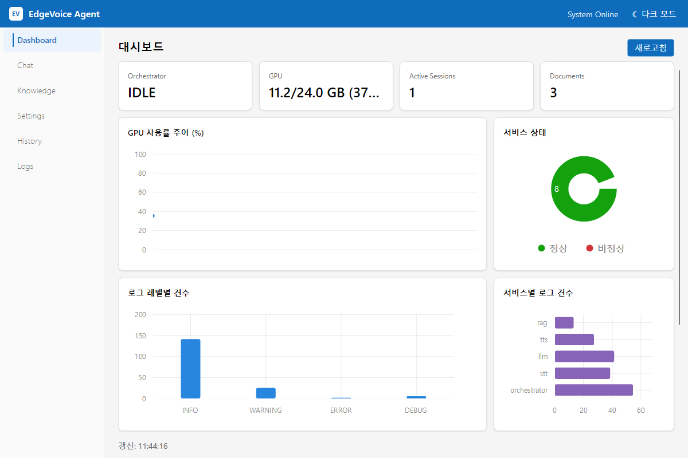 |
| **채팅** — 음성 대화와 한 세션, 최신이 위 | **대시보드** — GPU·서비스 상태·로그 건수 |

---

## 1. 음성 비서


- **호출어**: `hey_jarvis`(기본) · `alexa` · `hey_mycroft` — 설정에서 바꾸고 민감도를 조절합니다.
- **끼어들기**: 답하는 중에 말을 걸면 답을 멈추고 바로 듣습니다(스피커 소리와 내 목소리를 구분).
- **파형 창**: 누르면 듣기 시작 · 한 번 더 누르면 멈춤 · 오른쪽 클릭은 메인 창 · 끌어 옮긴 자리는 기억합니다.
- **말 끝**: 일정 시간(기본 2초) 조용하면 질문이 끝난 것으로 봅니다.

## 2. 채팅


- 음성으로 나눈 대화도 같은 세션으로 쌓여 글로 이어서 물을 수 있습니다(🎙 표시).
- 최신 대화가 맨 위. 이미지는 📎·Ctrl+V·끌어 놓기로 2장까지(장당 8MB).
- 지식에서 찾은 근거는 답 아래 `Sources:` 로, 웹 검색은 `🔎 검색함 · 출처` 로 보입니다.

<details><summary>다크 모드</summary>

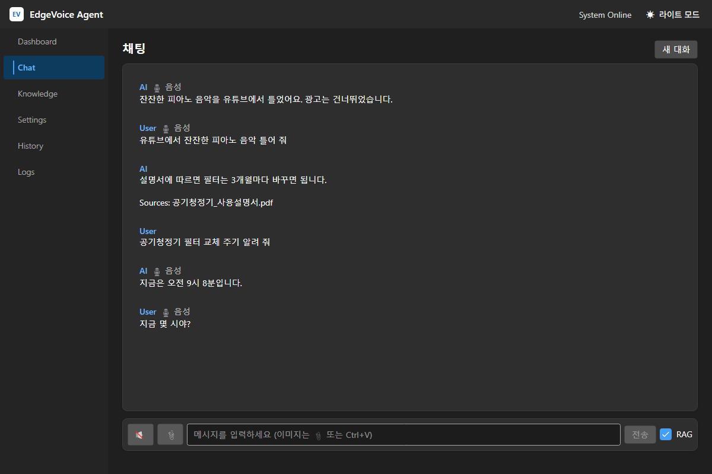
</details>

## 3. 지식(RAG)

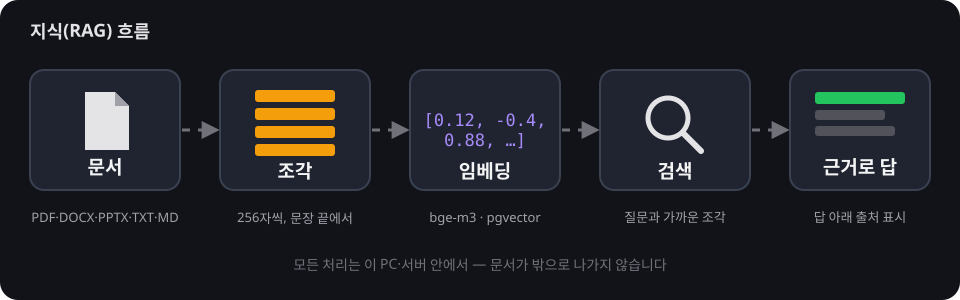

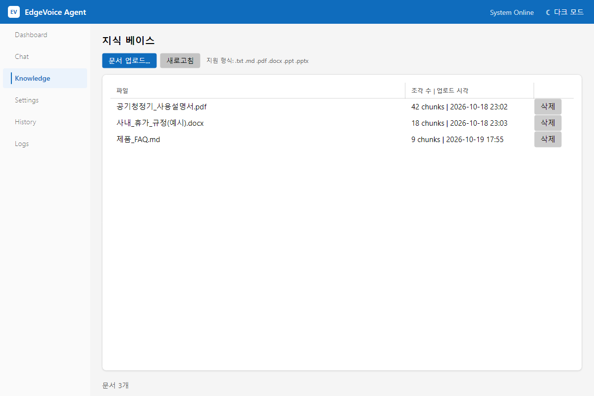

- **올리는 형식**: PDF · DOCX · PPT/PPTX · TXT · MD (텍스트는 UTF-8).
- **요령**
  - 사람들이 물어볼 **바로 그 낱말**을 본문에 넣으세요 — 애매한 조각은 질문의 핵심어가 들어 있을 때만 근거로 씁니다.
  - 표·그림 속 글자는 잘 읽히지 않습니다. 중요한 내용은 문장으로 적으세요.
  - 256자 조각으로 나뉘므로 한 문단에 한 가지 내용을 담으면 잘 찾습니다.
  - 말로 "○○ 기억해" 라고 하면 학습 노트로 지식에 저장됩니다.

## 4. 브라우저·컴퓨터 조작

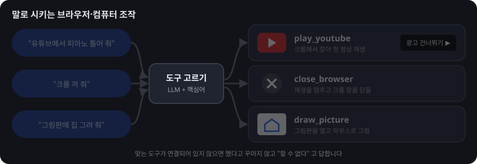

- "유튜브에서 ○○ 틀어 줘" → 크롬에서 찾아 재생, **광고는 말하지 않아도 자동으로 건너뜁니다**.
- "크롬 꺼 줘" → 재생을 멈추고 창을 닫습니다. "그림판에 ○○ 그려 줘" → 그림판을 열고 그립니다.
- 이 PC 에서 MCP 서버 두 개를 띄워 둡니다:
  ```powershell
  scripts/start-browser-mcp.ps1   # 브라우저(Playwright) :8931
  scripts/start-desktop-mcp.ps1   # 앱 열기·그림판 :8932
  ```
  그리고 `.env` 에 `MCP_CONFIG_PATH=/app/config/mcp/servers.json` (서버 목록은 `config/mcp/servers.json`, 설정 탭에서도 고칠 수 있음).

## 5. 설정

| | |
|---|---|
| 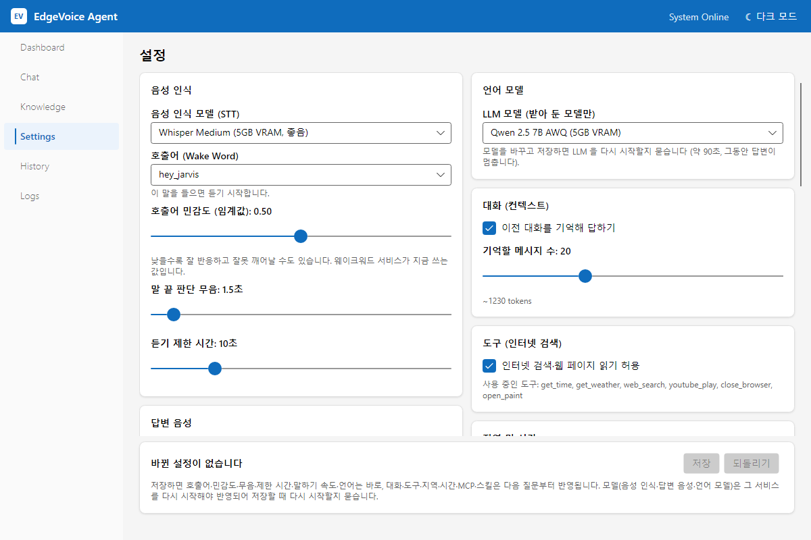 | 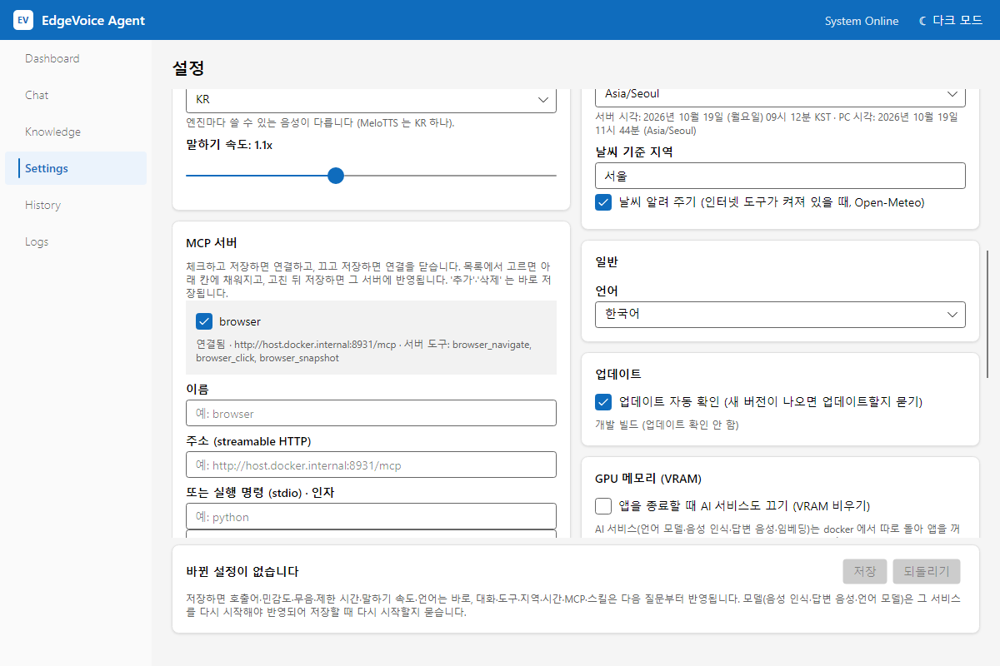 |
| 음성 인식·답변 음성·언어 모델, 호출어 민감도 | MCP 서버 · 일반 · **업데이트 자동 확인** |

- **저장 막대**: 여러 카드를 고친 뒤 한 번에 [저장]. 항목마다 "바로 반영 / 다음 질문부터 / 다시 시작해야 반영" 을 알려 줍니다.
- 모델을 바꾸면 [다시 시작] [나중에] 를 묻습니다(LLM 약 90초).
- **MCP 서버**·**스킬**: 체크로 켜고 끄며, 프롬프트 스킬(예: "항상 존댓말")을 추가할 수 있습니다.

<details><summary>더 보기 — 스킬·대화 기록·로그</summary>

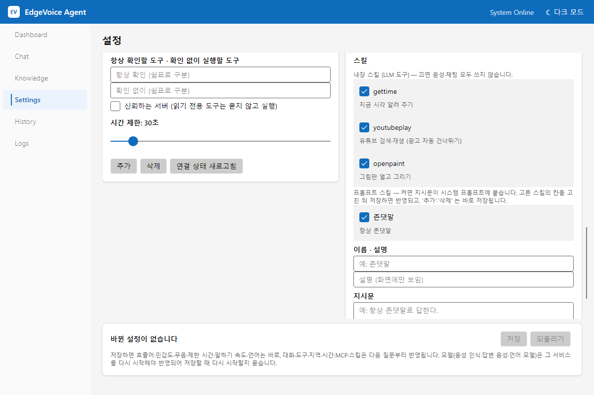
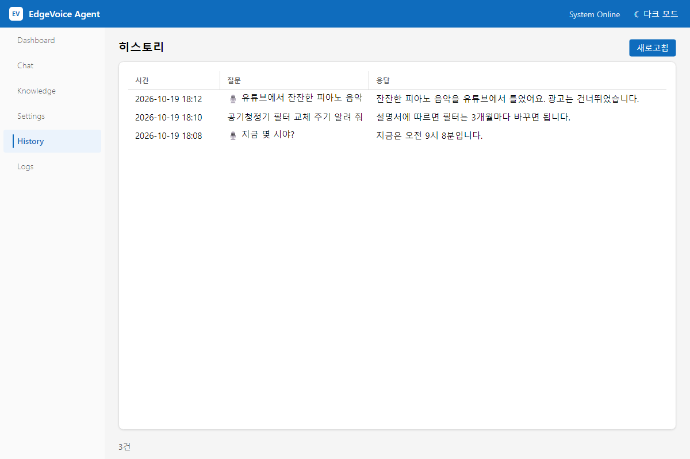
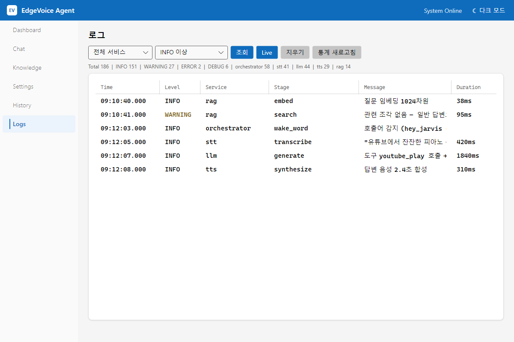
</details>

---

## 6. 설치·업데이트

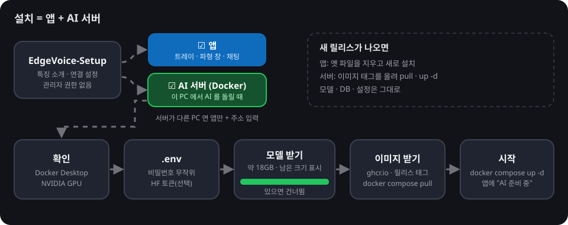


| 특징 소개 페이지 | 연결 설정 페이지 |
|---|---|
| 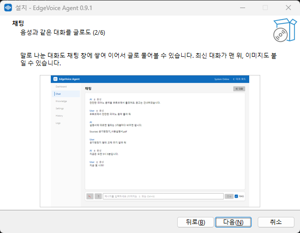 | 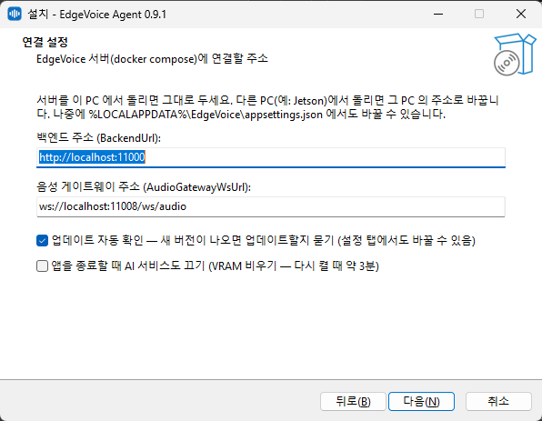 |

1. [Releases](https://github.com/ghlee0786/EdgeVoice/releases) 에서 `EdgeVoice-Setup-<버전>.exe` 를 받아 실행합니다(관리자 권한 필요 없음).
2. 특징을 넘겨 보고, **서버 주소** · **업데이트 자동 확인** · **종료할 때 AI 서비스 끄기** 를 정합니다.
3. **구성 요소**를 고릅니다.
   - **앱 + AI 서버**: AI 서버 폴더(모델이 들어가니 여유 있는 드라이브)와 HuggingFace 토큰(선택)을 받고, 설치가 끝나면 새 창에서
     Docker·GPU 확인 → `.env` 준비(DB 비밀번호 등은 **무작위**) → 모델 받기(남은 크기 표시, 있으면 건너뜀) → `docker compose pull` → `up -d` 가 이어집니다.
     끊겼으면 시작 메뉴의 **EdgeVoice AI 서버 준비** 를 다시 실행하면 이어서 합니다.
   - **앱만**: 서버가 다른 PC(예: Jetson) 에 있을 때 — 그 주소만 넣습니다.
4. 앱은 `%LOCALAPPDATA%\Programs\EdgeVoice`, 설정은 `%LOCALAPPDATA%\EdgeVoice\appsettings.json` (업데이트·제거 후에도 남음).
5. 새 릴리스가 나오면 앱이 시작할 때 **"업데이트할까요?"** 를 묻고, [확인] 이면 앱을 닫고 → 옛 파일을 지우고 → 새로 깔고 → 다시 띄웁니다.
   AI 서버도 함께 새 이미지 태그로 `pull · up -d` 합니다(모델·DB·`.env` 는 그대로). 묻지 않게 하려면 설정 탭의 *업데이트 자동 확인* 을 끕니다.

## 7. VRAM 비우기 (선택)

AI 서비스는 docker 에서 앱과 따로 돌아 **앱을 꺼도 VRAM 을 잡고 있습니다**(언어 모델만 약 15GB). 게임·영상 작업 등으로 GPU 가 필요하면:

- 트레이 메뉴 **AI 서비스 끄기 (VRAM 비우기)** — GPU 서비스(llm · stt · tts · embedding, 켜져 있으면 vision)를 `docker compose stop` 합니다. 꺼져 있으면 같은 자리가 **AI 서비스 켜기** 가 됩니다.
- 설정 › GPU 메모리 › **앱을 종료할 때 AI 서비스도 끄기** (기본 꺼짐) — 트레이 [종료] 때 함께 내립니다.
- 앱을 켤 때 GPU 서비스가 꺼져 있으면 자동으로 켜고, 준비될 때까지 파형 창·트레이에 **AI 준비 중 (약 3분)** 을 보여 줍니다.
- 서버가 다른 PC 에 있으면 이 메뉴는 나오지 않습니다.

## 8. 서버(docker compose)

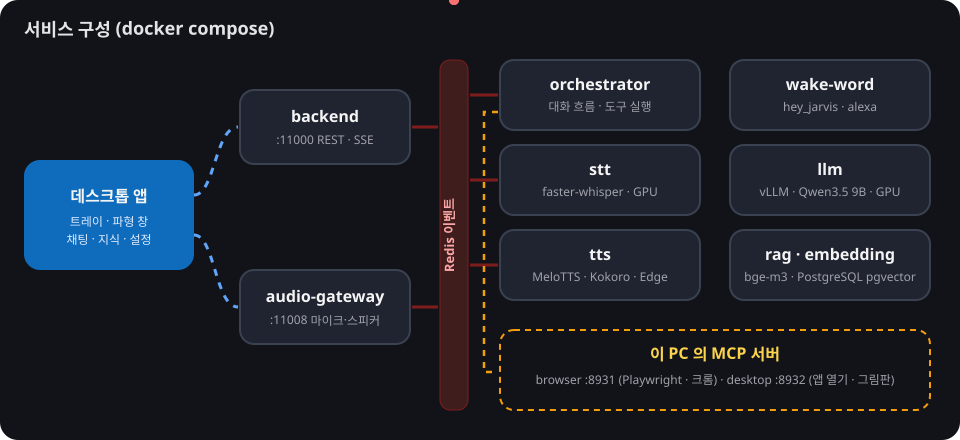

| 파일 | 쓰는 곳 |
|---|---|
| `deploy/docker-compose.yml` | **배포용** — 릴리스 이미지(`ghcr.io/ghlee0786/edgevoice-*:<태그>`)를 받아 띄운다. 설치 프로그램이 AI 서버 폴더에 둔다 |
| `docker-compose.dev.yml` | **개발용** — 소스에서 build. 서비스·환경변수·볼륨은 배포용과 같다(`tests/deploy` 가 확인) |

```powershell
# 배포용 (AI 서버 폴더 — 설치 프로그램이 deploy/ · shared/ · config/ · services/llm/edgevoice_guard · services/backend/static 을 둔다)
.\setup-server.ps1 -Version v1.2.3        # .env 준비(비밀 무작위) → 모델 받기 → pull → up -d

# 개발용
.\scripts\download-models.ps1 -DryRun     # 받을 모델·남은 크기만 보기 (빼면 받는다)
docker compose -f docker-compose.dev.yml up -d
docker compose -f docker-compose.dev.yml --profile search up -d   # 인터넷 검색(SearXNG)까지
```

**모델** — git·릴리스에는 넣지 않습니다(약 18GB · 각 모델의 라이선스). 모델 이름은 compose 파일 한 곳(`LLM_MODEL`·`STT_MODEL` 기본값, embedding 의 `MODEL_NAME`)에서 읽어 HuggingFace 에서 받습니다.

| 모델 | 용도 | 받는 곳 |
|---|---|---|
| [RedHatAI/Qwen3.5-9B-quantized.w4a16](https://huggingface.co/RedHatAI/Qwen3.5-9B-quantized.w4a16) | 언어 모델·도구·이미지 | `models/llm/hub` |
| [BAAI/bge-m3](https://huggingface.co/BAAI/bge-m3) | 임베딩(지식 검색) | `models/embedding` |
| [mobiuslabsgmbh/faster-whisper-large-v3-turbo](https://huggingface.co/mobiuslabsgmbh/faster-whisper-large-v3-turbo) | 음성 인식 | 볼륨 `edgevoice-stt-hf-cache` |
| [myshell-ai/MeloTTS-Korean](https://huggingface.co/myshell-ai/MeloTTS-Korean) · [kykim/bert-kor-base](https://huggingface.co/kykim/bert-kor-base) | 답변 음성(한국어) | 볼륨 `edgevoice-tts-hf-cache` |

> 각 모델은 HuggingFace 에서 받으며 **각자의 라이선스**를 따릅니다. 쓰기 전에 모델 페이지의 라이선스를 확인하세요.

**보안** — 배포용 compose 는 PostgreSQL·Redis 포트를 밖으로 열지 않고, DB 비밀번호·SearXNG 비밀은 `.env` 에서 받습니다(설치 때 무작위). 개발용 compose 의 `edgevoice/edgevoice` 비밀번호와 25432·26379 포트는 개발 PC 전용입니다.

| 서비스 | 호스트 포트 | 내용 |
|---|---|---|
| backend | 11000 | REST·SSE — 데스크톱 앱이 붙는 곳 |
| stt | 11001 | faster-whisper large-v3-turbo (GPU) |
| tts | 11002 | MeloTTS(한국어, 기본) · Kokoro · Edge TTS · gTTS |
| llm | 11003 | vLLM · Qwen3.5 9B (도구·이미지) |
| embedding | 11004 | BAAI/bge-m3 |
| wake-word | 11005 | OpenWakeWord |
| rag | 11006 | 지식 검색 |
| orchestrator | 11007 | 대화 흐름·도구 실행 |
| audio-gateway | 11008 | 마이크·스피커 WebSocket, 끼어들기·말 끝 판단 |
| postgres · redis | 25432 · 26379 (개발용만) | pgvector 지식 저장소 · 이벤트 버스 |

Jetson 은 `docker-compose.jetson.yml` (경량 모델).

## 9. 개발

```bash
# 데스크톱 앱
dotnet run --project clients/dotnet/src/EdgeVoice.Agent.Desktop
dotnet test clients/dotnet/EdgeVoice.Agent.sln

# 서비스 시험 (폴더마다 따로)
pip install -r requirements-ci.txt
python -m pytest tests/orchestrator -q -p no:cacheprovider

# README·설치 마법사 그림 다시 만들기 (가짜 데이터로 찍음)
python scripts/make_readme_assets.py

# 설치 프로그램 (Inno Setup 6) — publish + ISCC, CI·릴리스와 같은 스크립트
.\scripts\build-installer.ps1 -Version 1.2.3

# PowerShell 스크립트 구문 검사 (CI 와 같은 것)
.\scripts\check-powershell.ps1
```

- 업데이트를 확인하는 저장소는 `clients/dotnet/src/EdgeVoice.Agent.Desktop/UpdateChecker.cs` 의 `Repository` 한 곳에 있습니다.
- 데스크톱 앱 구조는 [clients/dotnet/README.md](clients/dotnet/README.md).

## 10. CI/CD

| 워크플로 | 언제 | 하는 일 |
|---|---|---|
| `ci.yml` | push(master) · PR | .NET build·test · pytest 묶음(`tests/deploy` 포함) · 바뀐 Python 파일 ruff · 서비스 docker build · **설치 프로그램 빌드**(`scripts/build-installer.ps1`) · **PowerShell 구문 검사**(5.1·7) · **배포용 compose config**. 같은 브랜치의 이전 실행은 취소 |
| `release.yml` | `v*` 태그 | 테스트 → exe zip + 설치 프로그램(같은 `build-installer.ps1`) → GitHub Release, 서비스 이미지 → ghcr |
| `deploy.yml` | 릴리스 publish · Release 워크플로 성공 · 수동(버전 지정) | **CD — 기본 꺼짐.** self-hosted runner(AI 서버 PC)에서 `deploy/update-server.ps1 -Version <태그>`: 서버 파일 교체 → 태그 바꾸기 → pull → up -d(모델·DB 볼륨 보존) → health 확인 → 실패하면 이전 태그로 되돌림 |

### CD 켜는 법

1. **AI 서버 PC 준비**: 설치 프로그램으로 [앱 + AI 서버] 를 한 번 설치합니다(서버 폴더·`.env`·모델이 생깁니다).
2. **self-hosted runner 등록**: 저장소 Settings › Actions › Runners › *New self-hosted runner* (Windows x64) 의 안내대로 서버 PC 에 설치하고, 라벨에 `edgevoice-server` 를 더합니다. 러너는 docker 를 쓸 수 있는 사용자 계정으로 돌려야 합니다(서비스로 돌리면 그 계정을 docker-users 그룹에).
3. **저장소 변수** (Settings › Secrets and variables › Actions › *Variables*):
   - `DEPLOY_ENABLED` = `true` — 이것이 없으면 deploy job 은 건너뜁니다.
   - `EDGEVOICE_SERVER_DIR` = AI 서버 폴더 (예 `D:\EdgeVoice\server`).
4. **(선택) 승인**: Settings › Environments › `production` 에 *Required reviewers* 를 지정하면 배포 전에 승인을 기다립니다.
5. 확인: Actions › *Deploy (AI 서버)* › *Run workflow* 에 `v1.2.3` 을 넣어 한 번 돌려 봅니다.

> 끄려면 `DEPLOY_ENABLED` 를 지우거나 `false` 로. 같은 일을 손으로 하려면 서버 폴더에서 `.\update-server.ps1 -Version v1.2.3` (명령만 보기: `-DryRun`).

## 라이선스

이 저장소의 코드는 [MIT 라이선스](LICENSE)를 따릅니다. 모델은 위 표의 각 모델 라이선스를 따릅니다.
